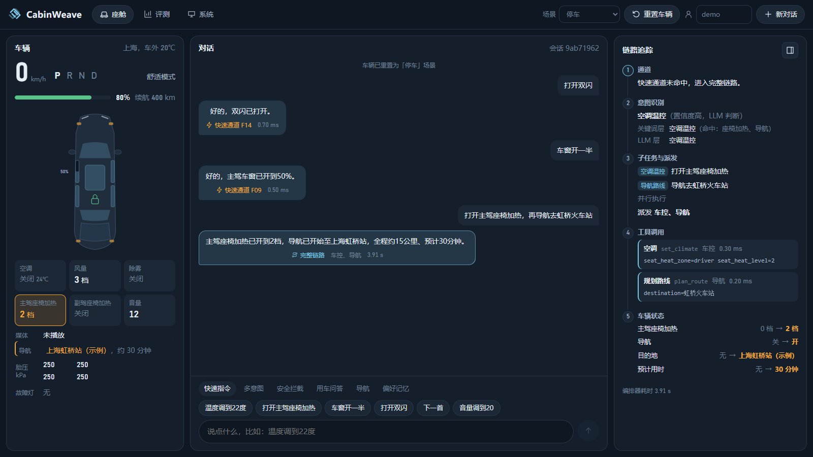
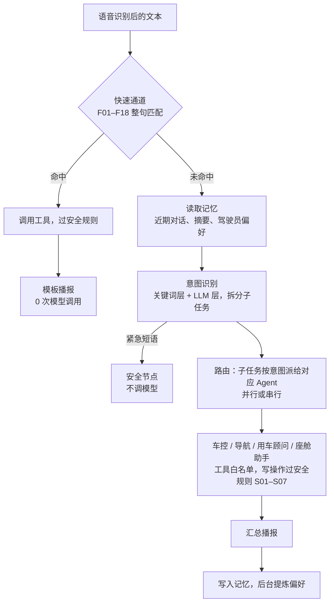
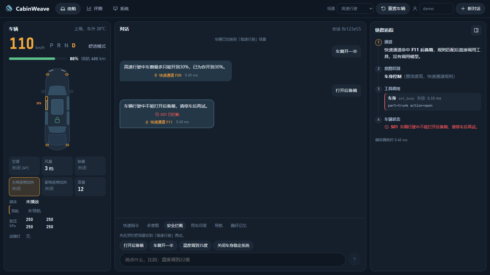
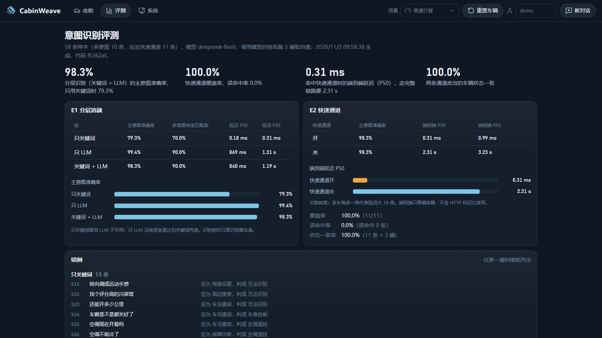

# CabinWeave

全栈多 Agent 智能交互系统。系统接收语音识别后的文本，识别意图（一句话有多个诉求时拆成子任务），交给车控、导航、用车顾问、座舱助手 4 个 LLM Agent 执行，紧急情况由不调模型的安全节点处理。车控指令都要经过安全规则，作用在按用户隔离的模拟车辆上。



## 亮点

- **快慢双通道**：18 条白名单规则整句匹配"温度调到22度""打开后备箱"这类简单指令，命中后直接调用工具并按模板播报，不调用模型；其余交给完整链路。评测中简单指令的端到端延迟（P50）从 2.31 s 降到 0.31 ms，覆盖率 100%、误命中 0，两条通道改出的车辆状态完全一致。
- **分层意图识别**：关键词层和 LLM 层识别 14 类座舱意图。58 条样本上主意图准确率 98.3%（只用关键词 79.3%）；紧急短语直达安全节点，约 0.4 ms 出结果；LLM 超时或失败时由关键词兜底。
- **多意图拆分与多 Agent 分工**：一句话拆成 2–4 个子任务，安全类优先，其余按意图派给对应的 Agent，同一 Agent 的多个子任务合并派发；并行为主，后一步依赖前一步结果时串行。各 Agent 只能调用自己白名单内的工具；某个 Agent 失败时只播报这一项失败，其余结果照常返回。
- **模拟车辆与安全规则**：车辆状态涵盖空调、座椅、车窗、灯光、导航、媒体、电量、胎压、故障灯等，写操作先过 S01–S07 七条安全规则，分拒绝、裁剪到边界、放行并提醒三类；6 个场景预设用于演示和评测。
- **用车手册 RAG**：用车顾问检索车辆用户手册，经过查询改写、并行召回和 LLM 重排；手册目录在启动时按内容哈希自动同步。
- **驾驶员偏好记忆**：Redis 保存近期对话和摘要，ChromaDB 保存驾驶员偏好；从对话中提炼常用温度、音乐、家和公司地址等，"按我习惯的温度""回家"这类说法可以直接用上。
- **可观测**：每轮返回所走通道、子任务、工具调用、状态变化和被拦截的操作；前端链路追踪按步骤展示，监控接口统计快慢通道和各规则命中次数。

技术栈：Python 3.12、FastAPI、AsyncIO、Redis、ChromaDB、Vue 3、Vite、Docker Compose；模型通过 Anthropic Messages API 兼容接口调用。

## 请求链路



## 评测

当前只包含意图识别，使用 58 条合成车载样本（实际评测时采用线上真实用户数据），其中单意图 48、多意图 10，调用模型的组各跑 3 遍取均值。详见 [意图评测](docs/项目介绍/08-意图评测.md) 和 [正式报告](backend/evaluation/报告/报告.md)。

**E1 分层消融**

| 组 | 主意图准确率 | 多意图完全匹配率 | 识别延迟 P50 |
|---|---|---|---|
| 只关键词 | 79.3% | 70.0% | 0.18 ms |
| 只 LLM | 99.4% | 90.0% | 869 ms |
| 关键词 + LLM | 98.3% | 90.0% | 840 ms |

**E2 快速通道开关**

| 快速通道 | 主意图准确率 | 端到端延迟 P50 | 端到端延迟 P95 |
|---|---|---|---|
| 开 | 98.3% | 0.31 ms | 0.99 ms |
| 关 | 98.3% | 2.31 s | 3.23 s |

快速通道覆盖率 100%（11/11），误命中率 0%（0/47），状态一致率 100%（33 次比较）。端到端延迟只算编排器，不含 HTTP 和记忆读写。

## 界面

座舱页的场景切换到「高速行驶」后，车窗开度被 S03 限制在 30%，打开后备箱被 S01 拦截：



评测页读取正式报告：



## 快速开始

在仓库根目录复制配置，填写 `ANTHROPIC_API_KEY`、`ANTHROPIC_MODEL` 和 `REDIS_PASSWORD`（Linux/macOS 用 `cp`）：

```powershell
Copy-Item .env.example .env
docker compose up -d --build
```

- 前端：http://127.0.0.1:5173
- API 文档：http://127.0.0.1:8000/docs
- 命令行对话：`docker compose exec backend python api/main.py --cli`
- 用车手册：[backend/manuals](backend/manuals/README.md) 收录了理想汽车官网帮助中心的公开页面，后端启动时自动导入知识库。
- 意图评测：`python backend/evaluation/运行评测.py`（读取根目录 `.env`，不需要启动 Docker）。

compose 项目名为 `cabinweave`，Redis、ChromaDB 和后端数据使用独立的数据卷。端口默认 8000 和 5173，和其他服务冲突时在 `.env` 里改 `BACKEND_PORT`、`FRONTEND_PORT`。服务接口没有用户鉴权，只用于本机。

后端单独运行（Python 3.12）需要可访问的 Redis；ChromaDB 服务连不上时自动改用本地嵌入式存储。在 `.env` 里设置 `REDIS_URL`、`CHROMA_HOST`、`CHROMA_PERSIST_DIRECTORY` 后：

```bash
cd backend
python -m pip install -r requirements-dev.txt
python -m uvicorn api.main:app --port 8000   # 或 python api/main.py --cli
python -m pytest -q
```

全部环境变量见 [.env.example](.env.example)。

## 目录

| 目录 | 内容 |
| --- | --- |
| backend/api | HTTP API（/chat、/vehicle/*、/profile、/eval/report 等）与 CLI |
| backend/agents | 角色、路由、多意图执行与工具 |
| backend/core | 意图识别、快速通道、Skills 加载 |
| backend/vehicle | 车辆状态、安全规则、车辆服务、模拟控制与模拟外部服务 |
| backend/memory | 对话记忆与驾驶员偏好 |
| backend/mcp | 手册知识库与工具执行管理 |
| backend/monitor | 运行指标与快慢通道统计 |
| backend/manuals | 车辆用户手册（官网公开页面） |
| backend/skills | 角色专属 Skill |
| backend/evaluation | 意图识别评测（样本、评测脚本、正式报告） |
| backend/tests | 后端单元测试（假客户端，不调用真实模型） |
| frontend | Vue 车机界面与 Nginx 同源代理 |

## 文档

- [项目介绍](docs/项目介绍/README.md)：按模块说明实现

## 当前边界

- 车辆、地图、天气、媒体、联系人都是进程内模拟，没有接入真实车控和外部服务；车辆状态保存在进程内，后端重启后恢复为默认场景。
- 输入是语音识别后的文本，系统本身不做语音识别和语音合成。
- 评测只覆盖意图识别，样本为合成数据（实际评测的时候接入的是线上真实用户数据），一个样本约占 1.7 个百分点。
